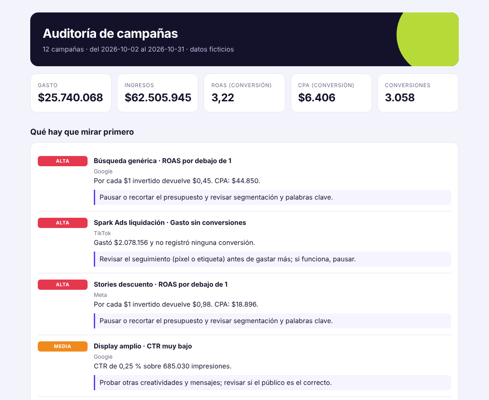

# Auditor de campañas

Programa en Python (pandas) que **audita una cuenta de publicidad digital**: limpia los datos, calcula las métricas de cada campaña y aplica reglas para decir **qué hay que mirar primero**: qué pausar, qué revisar y qué conviene escalar. Genera un informe de una página.

> **Todos los datos son ficticios.** `campanias.csv` lo genera `datos.py` con una semilla fija; algunas campañas tienen problemas plantados a propósito para que el auditor tenga algo que encontrar. No hay ninguna cuenta real en este repositorio.



Informe completo: [`informe.html`](informe.html) · Hallazgos en tabla: [`hallazgos.csv`](hallazgos.csv)

## El problema
Mirar una cuenta campaña por campaña, en el panel de cada plataforma, hace perder lo importante: una campaña que gasta mucho sin registrar ventas, otra que ya cansó a su público, otra que ni usa su presupuesto. El auditor junta todo y ordena los problemas por gravedad, con una acción sugerida para cada uno.

## Qué hace, paso a paso
1. **Limpia** (`limpiar`): descarta filas con valores vacíos, negativos, duplicadas, con más clics que impresiones o más conversiones que clics, y **cuenta cuántas descartó y por qué**. Es mejor auditar menos datos que datos falsos.
2. **Calcula** (`metricas`): CTR, CPC, CPM, CPA, ROAS, frecuencia y ejecución del presupuesto por campaña. Las divisiones por cero dan "sin dato" en vez de romper o dar infinito.
3. **Compara en el tiempo** (`cpa_por_ventana`): CPA de los últimos 7 días contra los 7 anteriores.
4. **Aplica reglas** (`auditar`): cada una tiene su umbral configurable.

| Regla | Severidad | Se aplica a |
|---|---|---|
| Gasto sin conversiones (posible seguimiento roto) | alta | Conversión |
| ROAS por debajo de 1 | alta | Conversión |
| CTR muy bajo (con volumen mínimo) | media | todas |
| Frecuencia alta | media | todas |
| CPA en aumento (+30 % vs semana anterior) | media | Conversión |
| Se pasa del presupuesto | media | todas |
| No gasta su presupuesto | baja | todas |
| Candidata a escalar (ROAS alto y gasta todo) | oportunidad | Conversión |

ROAS y CPA **solo se juzgan en campañas de conversión**: una campaña de alcance no existe para vender, y evaluarla así daría falsas alarmas.

## Cómo correrlo
Necesita Python 3.9 o más nuevo y pandas.

```
pip install pandas
python auditor.py                 # audita campanias.csv
python auditor.py mis_datos.csv   # o un archivo propio con las mismas columnas
```
Columnas: `fecha, campania_id, campania, plataforma, objetivo, presupuesto_diario, gasto, impresiones, alcance, clics, conversiones, ingresos`.

## Pruebas
```
python -m unittest -v
```
35 pruebas: limpieza, fórmulas, cada regla (cuándo salta y cuándo no), formato y que los problemas plantados en los datos ficticios se encuentren.

## Archivos
`auditor.py` · `datos.py` (generador) · `test_auditor.py` · `campanias.csv` · `informe.html` · `hallazgos.csv`

## Límites
- Las reglas y los umbrales son un punto de partida razonable, no una verdad: dependen del rubro y del margen de cada negocio.
- La frecuencia es el promedio diario de impresiones por persona alcanzada (el alcance diario no se puede sumar sin contar dos veces a la misma persona).
- Desarrollado con ayuda de Claude; la idea, las reglas de negocio y la revisión son mías.
